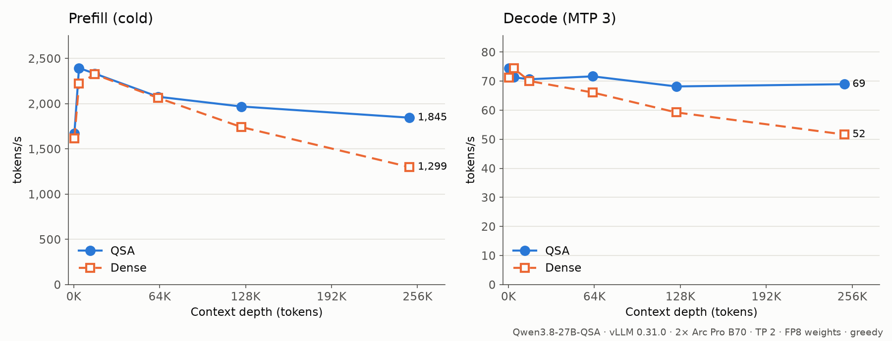

# Qwen3.8-QSA-vLLM-XPU

Run [Qwen3.8-27B-QSA](https://huggingface.co/higa2515/Qwen3.8-27B-QSA-BF16) on Intel GPUs with vLLM,
including its sparse attention.

QSA ([paper](https://arxiv.org/abs/2608.30320)) adds a small learned indexer to each of the model's 16
full-attention layers. For each query, the indexer picks 2,048 earlier tokens, and the layer attends only
those. As a result, speed hardly depends on context length. Below 32K, where attending everything is
still cheaper, the plugin attends densely instead. The reference engine,
[kuraneko1/Qwen3.8-27B-QSA-llama.cpp](https://github.com/kuraneko1/Qwen3.8-27B-QSA-llama.cpp), targets
NVIDIA GPUs. This repository is a vLLM plugin that brings the same sparse path to Intel XPU. It has been
tested on 2× Arc Pro B70.



Throughput in tokens/s:

| Context | Prefill, QSA | Prefill, dense | Decode, QSA | Decode, dense |
|--------:|-------------:|---------------:|------------:|--------------:|
| 0.5K | 1,669 | 1,617 | 74.5 | 71.2 |
| 4K | 2,394 | 2,221 | 71.3 | 74.4 |
| 16K | 2,333 | 2,324 | 70.6 | 70.0 |
| 64K | 2,076 | 2,064 | **71.6** | 66.1 |
| 128K | **1,969** | 1,741 | **68.2** | 59.2 |
| 256K | **1,845** | 1,299 | **68.9** | 51.6 |

At 256K, QSA prefills 1.42× and decodes 1.34× as fast as dense. Up to 32K both attend densely, and
the two runs are within a few percent of each other. The QSA numbers were measured with indexers
fine-tuned locally on long agent traces (not published yet); the release's indexers run at the same
speed but accept fewer MTP tokens at long context.

The two runs differ only in attention. Both use the same vLLM build and the same `scripts/serve.sh` settings:

- tensor parallel 2;
- online FP8 weights;
- MTP with 3 draft tokens;
- greedy decoding.

Dense loads the release as plain Qwen3.5, so its indexers are ignored. The prompts are vLLM's source
code. Prefill is measured cold, as prompt tokens per second until the first token. Raw results are in
[`docs/results`](docs/results).

A needle test (three passphrases at 15%, 50% and 85% of the context) found 3 of 3 from 6K to 230K.
Tool calls and image input work.

## Quick start

You need:

- vLLM 0.31.0 for Intel XPU. Use [vLLM's XPU install guide](https://docs.vllm.ai/en/latest/getting_started/installation/gpu.html), or work inside `vllm/vllm-openai-xpu:v0.31.0`.
- An Xe2 GPU. For 256K of context, two 32 GB cards.
- The [52 GB release](https://huggingface.co/higa2515/Qwen3.8-27B-QSA-BF16).

```bash
git clone https://github.com/NoobBandi/Qwen3.8-QSA-vLLM-XPU && cd Qwen3.8-QSA-vLLM-XPU

# 0.1.15, which ships with vLLM 0.31.0, overflows with QSA's KV layout (see Pitfalls)
pip install "vllm_xpu_kernels==0.1.17.1" --extra-index-url https://vllm-project.github.io/vllm-xpu-kernels/whl
pip install -e .        # vLLM finds the plugin through its entry point

python3 scripts/make_overlay.py /models/Qwen3.8-27B-QSA-BF16   # -> .../vllm-qsa (config only, weights are symlinked)
scripts/serve.sh /models/Qwen3.8-27B-QSA-BF16/vllm-qsa --port 8000
```

`serve.sh` runs `vllm serve` with the settings measured above. The first start takes a few minutes longer,
while kernels compile. If you write your own command, keep these settings:

- `vllm::qwen38_qsa_with_output` in `splitting_ops`. Otherwise the device is lost.
- `cudagraph_mode: FULL_DECODE_ONLY`. With PIECEWISE, decode drops to about 20 tok/s.
- `--max-num-batched-tokens 4096`.
- `VLLM_SPARSE_INDEXER_MAX_LOGITS_MB=128`, which leaves room for 256K of KV cache.

## How it works

- **Model.** The plugin registers `QSAQwen3_5ForConditionalGeneration`: vLLM's Qwen3.5 with QSA
  attention, adapted from vLLM's Qwen4Exp QSA to match the release's `modeling_qsa.py`. The backbone
  weights load unchanged.
- **Kernels.** Scoring and attention are Triton kernels tuned for Xe2; attention uses KaloyanNaumov's
  `attn2`. Top-k is exact (see Pitfalls). The indexer runs in BF16; against an FP32 recompute of the
  reference selection at 136K, it picks 511 of the same 512 blocks.
- **Tool-call pinning.** The block holding each of the newest 64 `<tool_call>` tokens, and the two
  blocks after it, are always attended. This goes beyond the release's selection rule. In long agent
  sessions the indexer rarely picks earlier tool calls. Without them, the model can write
  `<|im_start|>` where `<function=` belongs, and the parser drops the call: an agent then stops
  mid-task. In a 136K-token session, a failing call went from 3 valid of 36 samples to 36 of 36, which
  matches dense. `QWEN38_QSA_PIN_CAP=0` turns it off.
- **Dense below 32K.** QSA's selection costs about the same at any length, while dense attention grows
  with the context. On 2× B70 a sparse decode step is already the faster one past about 12K, but dense
  accepts more MTP tokens, which evens tok/s out near 32K. Steps whose longest context is within
  that attend densely through XPU flash, and the indexer keeps its caches up to date, so a request that
  grows past it turns sparse with everything in place. A decode step is one XPU graph, so every graph
  is captured twice, dense and sparse, and the step replays the one that matches.
  `QWEN38_QSA_DENSE_BELOW` sets the threshold in tokens (0 turns it off).
- **Prefill** past the threshold is sparse as well as decode.
- **MTP draft.** The draft layer is sparse too, and borrows layer 63's indexer, because the checkpoint
  has none for it. It attends 4,096 tokens, and the newest 1,024 are always among them. Set
  `QWEN38_QSA_DRAFT_BUDGET` and `QWEN38_QSA_DRAFT_RECENT` to change those numbers.
- **XPU graphs.** Selection, the cache update and attention form one custom op, so a whole decode step
  is captured as one XPU graph.
- **Radix-select top-k.** Under a captured graph, decode's scores are as wide as the longest context
  the cache holds (65,728 blocks at 256K), and `torch.topk` over them took 0.135 ms in each of the 17
  sparse layers of a step whatever the context. A radix select over only the visible blocks
  ([`radix_topk.py`](qwen38_qsa/ops/radix_topk.py)) takes 0.03–0.06 ms and picks the same values, which
  made every sparse decode step about 2.4 ms (5%) shorter.

## Pitfalls on XPU

- **XPU flash attention follows a KV block stride only in multiples of 64 token rows.** QSA packs the
  indexer's keys beside each block's K/V, which puts blocks 14,586 rows apart, and flash silently reads
  the wrong rows (about 50% error). The plugin pads each block to a multiple of 64 rows (12 KiB) and
  shows flash the cache as 64-token blocks. See
  [`repro/xpu_flash_block_stride.py`](repro/xpu_flash_block_stride.py). Triton's `unified_attention`
  follows any stride but is 20–300× slower at decode here.
- **vllm-xpu-kernels 0.1.15 overflows int32 GDN offsets** with this layout and loses the device
  ([#658](https://github.com/vllm-project/vllm-xpu-kernels/issues/658)). Install 0.1.17.1 instead.
- **vllm-xpu-kernels' `top_k_per_row_decode` is not exact.** It returns duplicate indices, and so drops
  candidates, when a row has many equal scores or a group far above the rest. This is the same class of
  bug as [vllm#51782](https://github.com/vllm-project/vllm/issues/51782) on CUDA. Decode uses its own
  radix select; prefill repairs only the rows that came back with duplicates
  ([`tests/test_topk.py`](tests/test_topk.py)).
- **Triton on XPU drops a masked `atomic_add` whose mask comes straight from `tl.histogram`'s
  result**: nothing is written. Storing the histogram and loading it back first works.
- **A custom op inside an inductor partition can lose the device.** Add it to `splitting_ops`.

## Limitations

- Tested only on 2× Arc Pro B70 with vLLM 0.31.0.
- At 256K, the borrowed draft indexer accepts 1.9–2.2 of 3 MTP tokens per step, varying between runs
  (1.95 with the release's indexers); dense accepts 2.27.
- The release's indexers were distilled at 16K on web text with the backbone frozen (the paper's stage
  1 only). Tool-call pinning makes up for what they miss in long agent sessions.
- Requests with images are attended sparsely. The reference runs them dense; long multimodal contexts
  were not tested.
- Without a per-card affinity patch, two-card runs pin about 64 GB of host RAM
  ([intel/compute-runtime#953](https://github.com/intel/compute-runtime/issues/953)).

## Development

```bash
python3 tests/test_kernels.py          # kernels against a torch reference, on XPU
python3 tests/test_prefill_select.py
python3 tests/test_topk.py             # top-k exactness
python3 tests/test_radix_topk.py       # decode's radix select against torch.topk, and its time
python3 tests/test_pins.py             # tool-call pinning (CPU)
python3 tests/test_regime.py           # dense/sparse graph switching (CPU)

# Benchmarks against a running server. corpus.txt is any long text; vLLM's source works:
find "$(python3 -c 'import vllm, os; print(os.path.dirname(vllm.__file__))')" -name "*.py" | sort | xargs cat > corpus.txt
python3 bench/needle.py --url http://127.0.0.1:8000    # also bench/decode.py, bench/prefill.py
python3 scripts/make_overlay.py /models/Qwen3.8-27B-QSA-BF16 --dense
bench/sweep.sh .../vllm-qsa .../vllm-dense               # data for the chart above
python3 bench/plot.py
```

These variables help with debugging: `QWEN38_QSA_DENSE`, `QWEN38_QSA_SYNC`, `QWEN38_QSA_PROFILE`,
`QWEN38_QSA_UNFUSED` and `QWEN38_QSA_EXACT_TOPK=0` (the stock top-k), see the source.

## Credits

- Model and QSA training: [higa2515](https://huggingface.co/higa2515)
  ([Qwen3.8-27B-QSA-BF16](https://huggingface.co/higa2515/Qwen3.8-27B-QSA-BF16)).
- Reference llama.cpp engine: [kuraneko1](https://github.com/kuraneko1)
  ([Qwen3.8-27B-QSA-llama.cpp](https://github.com/kuraneko1/Qwen3.8-27B-QSA-llama.cpp)).
- Qwen4Exp QSA implementation: [vLLM](https://github.com/vllm-project/vllm)
  ([`vllm/models/qwen4_exp`](https://github.com/vllm-project/vllm/tree/v0.31.0/vllm/models/qwen4_exp)).
- Xe2 attention kernel, prefill launch and the sparse-draft idea: [KaloyanNaumov](https://github.com/KaloyanNaumov),
  in zhaohb/vllm [#2](https://github.com/zhaohb/vllm/pull/2), [#8](https://github.com/zhaohb/vllm/pull/8)
  and [#4](https://github.com/zhaohb/vllm/pull/4).

Apache-2.0. See [NOTICE](NOTICE).
